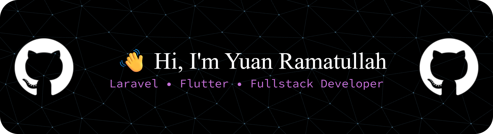

<div align="center">



<br/><br/>


<br/>

<a href="https://github.com/ramatullah12">
  
</a>

</div>

---

### 👨‍💻 About Me

```text
👋 Hi, I'm Yuan Ramatullah!
🎓 Information Systems Enthusiast & Software Developer
💼 Passionate about building robust Laravel Web Apps & cross-platform Flutter Mobile Apps
⚡ Focus: High performance, clean architecture, responsive UI/UX, and cloud database integrations
🌱 Currently exploring advanced Flutter architectures & modern cloud deployments
```

---

### 💻 Tech Stack & Tools

<div align="center">

<a href="https://skillicons.dev">
  
</a>

<br/><br/>

| Category | Technologies & Tools |
| :--- | :--- |
| **Backend** | Laravel, PHP, REST API, Express.js, Node.js |
| **Frontend** | Tailwind CSS, JavaScript (ES6+), HTML5, CSS3, Blade |
| **Mobile** | Flutter, Dart, Android Development, Firebase Cloud Messaging (FCM) |
| **Database & Cloud** | MySQL, Firebase Firestore, Cloudinary, Vercel |
| **Dev Tools** | Git, GitHub, VS Code, Postman, Figma |

</div>

---

### 📊 GitHub Analytics

<div align="center">

<table border="0">
  <tr>
    <td align="center" width="50%">
      
    </td>
    <td align="center" width="50%">
      
    </td>
  </tr>
</table>

<br/>


</div>

---

### 🐍 Contribution Activity & Snake

<div align="center">

<picture>
  <source media="(prefers-color-scheme: dark)" srcset="https://raw.githubusercontent.com/ramatullah12/ramatullah12/output/github-contribution-grid-snake-dark.svg" />
  <source media="(prefers-color-scheme: light)" srcset="https://raw.githubusercontent.com/ramatullah12/ramatullah12/output/github-contribution-grid-snake.svg" />
  
</picture>

</div>

---

### 📈 Coding Activity Graph

<div align="center">


</div>

---

### 🚀 Featured Projects

| 🚀 Project | 📖 Description | 🛠️ Tech Stack |
| :--- | :--- | :--- |
| **🚜 Rakentra** | Heavy Equipment Rental Management Information System | Laravel, MySQL, Bootstrap |
| **🏠 Perumahan App** | Housing & Property Management Information System | Laravel, MySQL, Tailwind CSS |
| **🎫 Ticket Reservation** | Online Ticket Reservation & Booking Management Platform | Laravel, REST API, MySQL |
| **📱 Flutter Applications** | Cross-platform Mobile Applications integrated with Cloud Backend | Flutter, Dart, REST API |
| **🔔 Firebase Notification App** | Real-time Push Notification Delivery System | Flutter, Firebase FCM |

---

### 🎯 Current Focus & Exploration

| Focus Area | Description |
| :--- | :--- |
| 🚜 **Heavy Equipment Rental System** | Enterprise-grade Laravel management information system |
| 📱 **Cross-Platform Mobile Apps** | Seamless Flutter user experience with state management |
| 🔥 **Firebase Services** | Authentication, Cloud Messaging (FCM) & Firestore Realtime DB |
| 🌐 **Scalable REST APIs** | Secure API architecture, JWT authentication & rate limiting |
| 📊 **Analytics Dashboards** | Interactive business reports and monitoring dashboards |
| ☁️ **Cloud Deployment** | Production deployment with modern DevOps practices |

---

### 📫 Connect With Me

<div align="center">

<a href="https://github.com/ramatullah12" target="_blank">
  
</a>
&nbsp;
<a href="https://www.linkedin.com/in/yuan-ramatullah/" target="_blank">
  
</a>
&nbsp;
<a href="mailto:yuantullah@gmail.com">
  
</a>

</div>

---

<div align="center">


<br/>

### 🚀 Laravel • Flutter • Fullstack Developer
⭐ *Thanks for visiting my GitHub Profile! Feel free to star my repositories.* ⭐

</div>
